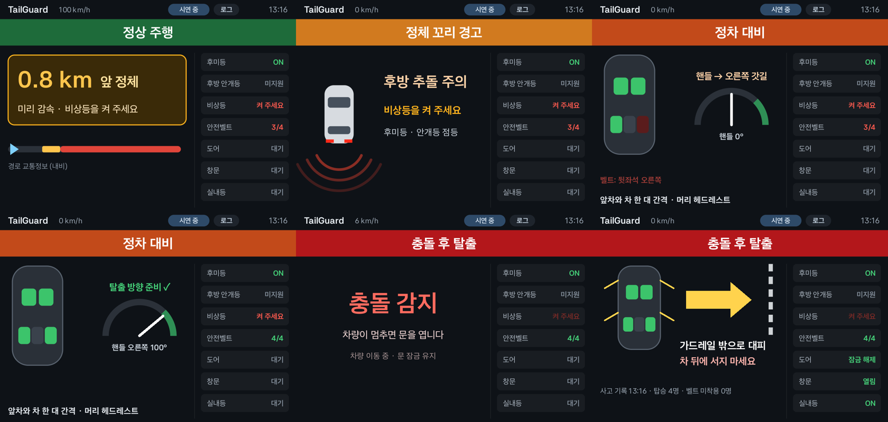

# TailGuard — 정체 꼬리 후방 대형차 추돌 생존 앱

고속도로 정체 꼬리에 멈춘 차의 탑승자가 후방 대형차 추돌에서 살아남도록 돕는 Pleos Connect 차량용 앱.
후방 카메라로 대형차(버스·트럭)의 급속 접근을 감지하고, 뒤차가 더는 멈출 수 없다고 판정되는 순간 생존 자세를 만든다.

> 정체 꼬리 대형차 추돌은 탈출할 틈 없이 사망 아니면 중상으로 구출되는 사고다. 승부는 충돌 전 몇 초에 난다.

## 동작 단계

| 단계 | 판정 | 동작 | 상태 |
|---|---|---|---|
| ① 전방 정체 예고 | 70km/h↑ 주행 중 내비 경로상 정체 시작이 1.5km 안 | 후방 조명 요청, 음성 예고 | 구현 |
| ② 정체 꼬리 경고 | 최근 6초 최고 70km/h↑, 현재 40km/h↓, 감속 폭 35km/h↑ | 후방 조명 요청, 비상등 안내 | 구현 |
| ③ 정차 대비 | 경고 상태에서 3km/h↓ 1초 | 좌석별 벨트 안내, 등받이 세우기, 앞차 간격·헤드레스트 안내 | 구현 |
| ④ 후방 접근 감지 | 후방 영상의 버스·트럭, 충돌까지 4초 이내, 접근 30km/h↑ | 후방 조명 점멸, "충격에 대비하세요" | 구현 |
| ⑤ 충돌 확실 · 생존 자세 | 뒤차가 남은 거리에서 멈추는 데 필요한 감속도 > 대형차 최대 감속도(6.5 m/s²), 또는 충돌까지 0.8초 이내 | 바퀴 45° 급속 조향(시뮬레이션), 등받이 세우기 | 구현 (조향은 화면 시뮬레이션) |
| ⑥ 구출 지원 | 충돌(에어백) 후 5km/h↓ 2초 | 도어 잠금 해제, 실내등, 사고 기록(시각·탑승 인원·벨트 미착용 인원) | 일부 (구조 요청 개발 중) |

- **저속 무반응** — 접근 속도 30km/h 미만은 반응하지 않는다. 저속 추돌·차간거리를 좁혀 붙는 차에 경고하지 않기 위해서.
- **설정** (화면 상단 [설정]) — 후방 감지 켜기/끄기 · 시내에서도 동작(기본 꺼짐, 내비 도로 제한속도·주소로 시내 판단) · 내비 정체 구간에서만 동작.
- **하지 않는 것** — 판정이 확실하지 않을 때 조향, 주행 중 화면 조작 요구. 바퀴 조향 제어는 차량 제조사 영역이라 앱은 판정과 화면 시뮬레이션까지만 한다.

## 후방 접근 감지 방식

1. 후방 영상 프레임에서 EfficientDet-Lite0(COCO 학습, TensorFlow Lite)로 승용차·버스·트럭을 기기 안에서 인식. 화면 가운데(바로 뒤 차로)의 차를 우선 추적.
2. 충돌까지 남은 시간 τ: 박스 폭의 역수(거리에 비례)를 시간에 대해 직선 맞춤(Theil–Sen, 튀는 프레임에 강함) → τ = 현재값 ÷ 감소 속도. 거리 센서 불필요.
3. 거리 ≈ 차폭 × 초점거리 ÷ 박스 폭 (카메라 화각으로 초점거리 환산), 접근 속도 = 거리 ÷ τ, 필요 감속도 = 속도² ÷ (2 × 거리).
4. 같은 차를 프레임마다 버스·트럭·승용차로 바꿔 부르는 경우가 있어, 버스·트럭은 한 부류로 묶고 최근 판정의 다수결로 대형차 여부를 정한다.

### 실제 블랙박스 영상으로 확인 (에뮬레이터, 검증 입력 경로)

| 영상 | 결과 |
|---|---|
| 후방 카메라, 대형 트럭 고속 추돌 | 경고 · 충돌 확실 · 바퀴 45° 발동 — 충돌 0.3초 전 (먼 트럭이 작게 찍혀 늦음) |
| 후방 카메라, 픽업트럭 저속 추돌 | 반응 없음 (추정 접근 13km/h 이하) |

실제 사고 영상은 저작권 때문에 저장소·APK에 넣지 않았다. APK의 시연 입력(`app/src/main/assets/rear_demo/`)은 생성형 AI로 만든 재연 영상 프레임이다.

## 사용 API

- AAOS Car API: `PERF_VEHICLE_SPEED`
- Pleos Vehicle SDK 2.3.2 — 읽기: SteeringWheel, Seat(착석·벨트), Safety(에어백) / 제어: Light(후미등·후방 안개등·실내등), Door(잠금), Window(위치), Seat(등받이)
- Pleos NaviHelper 3.0.5 — `getRouteStateInfo()`(전방 정체 거리), `getCurrentLocationInfo()`·`onCurrentRoadSpeedLimit`(시내·고속도로 구분)
- Pleos TextToSpeech 3.3.1 (실패 시 안드로이드 TTS)
- TensorFlow Lite 2.16.1 + EfficientDet-Lite0 (`app/src/main/assets/efficientdet_lite0.tflite`)
- 후방 카메라 실시간 입력: Pleos 카메라 영상 API(`PleosCameraManager`) 연결 예정 — 일반 앱 사용 가능 여부 확인 중

## 구조

```
app/src/main/java/ai/tailguard/
  core/TailGuardEngine.kt        ①~③·⑥ 판단 엔진 (순수 Kotlin, SDK 의존 없음)
  core/RearApproachJudge.kt      ④⑤ 후방 접근 판정 (순수 Kotlin)
  core/RearGate.kt               설정·도로 구분·정체 구간 조건
  core/DemoScenario.kt           봉평터널 상황 재현 입력 열
  vehicle/RearVehicleDetector.kt 후방 차량 인식 (TensorFlow Lite)
  vehicle/RearFrameSource.kt     후방 프레임 공급 (시연 영상 / 검증 영상)
  vehicle/PleosVehicleGateway.kt Pleos SDK 입력 수신·동작 실행
  vehicle/CarSpeedSource.kt      AAOS 차속
  vehicle/NaviTrafficSource.kt   내비 교통정보·현재 위치·도로 제한속도
  Speaker.kt                     음성
  ui/DashboardView.kt            화면 (단계 배너·카드·후방 카메라·설정·차량 상태 열)
  MainActivity.kt                연결, 시연 재생, 설정 저장
app/src/test/java/ai/tailguard/core/   단위 테스트 30건
```

## 빌드 · 실행

- 요구: JDK 17, Android SDK 36, Pleos Connect Emulator v2.1.0 (AVD)
- `gradlew testDebugUnitTest assembleRelease`
- 설치: `adb install -r -g apk/SKAI_4_TailGuard_release.apk` (`-g` 로 차량·내비·TTS 권한 일괄 부여)
- 상단 [▶ 시연]: 차량 신호 없이 전체 흐름 재생 (정차 후 후방 시연 영상으로 ④⑤ 판정). 에뮬레이터는 인식이 느려(프레임당 약 0.4초) 후방 구간이 실제보다 느리게 재생되며, 판정은 영상 속 시각 기준이라 결과는 같다.
- 상단 [설정]: 후방 감지 설정 3가지. [로그]: 동작·제어 결과 기록.
- 검증 입력: 앱 전용 폴더 `files/rear_test/NNN.jpg`(10fps, 선택 `hfov.txt` = 카메라 수평 화각)에 프레임을 넣으면 시연이 그 영상으로 판정한다.

## 확인 결과 (Pleos Connect Emulator v2.1.0)

- 단위 테스트 30건 통과 (후방 감지 10 · 설정 6 · 엔진 14)
- 제어 응답: 후미등, 실내등, 등받이(3좌석), 도어 잠금 해제(탑승 도어 4곳), 창문 4개
- 수신: 조향각, 좌석 착석·벨트, 내비 경로 상태
- 에뮬레이터 미지원 → 실차 확인 필요: 후방 안개등, 에어백 전개 신호, Pleos 온디바이스 음성 엔진
- 미확인: 조향각 부호, 등받이 방향, 창문 열림 값, 내비 정체 거리 단위, 주행 중 제어 권한 승인


